# PI-QGAT: Physics-Informed Quantum Graph Attention Network for Muon pT Regression

A compact hybrid quantum–classical graph neural network that predicts the transverse momentum (pT) of muons from CMS endcap muon trigger hits. The model has only **144 trainable parameters** and uses a 4-qubit variational circuit as the edge-interaction block of a graph attention network. The quantum circuit is simulated exactly with a fast closed-form JAX backend, verified against PennyLane.

The repository contains the main model and a broad ablation study covering the quantum circuit design, the physics prior, the graph architecture, the detector stations and the input features.

---

## 📌 Highlights

- **Test R² = 0.8395** on log(1+pT) and **MAE = 11.85 GeV** on 707,614 held-out events, with just 144 parameters (288 bytes in float16).
- **Fast inference:** 3.9 µs per event (≈256k events/s on CPU) using the constant-folded circuit.
- The quantum interaction block beats a **parameter-matched classical block trained from scratch** by +0.22 R² (0.8395 vs 0.6150).
- **Distillation shows the circuit's function is classically representable:** a 252-parameter classical student reaches R² 0.8384 (within 0.001 of the teacher), and a warm-started 144-parameter classical control reaches 0.8301. The quantum block's main value here appears to be a better optimisation path rather than a function class that classical models cannot express.
- **Entanglement matters, topology does not:** removing entanglement drops R² by 0.25, while ring, linear and all-to-all topologies differ by only 0.0015.
- **Data-dependent entangling angles** are the key ingredient: adaptive RZZ beats fixed RZZ, and the attribution analysis shows adaptivity matters about 8× more than the choice of gate.

---

## 🔬 Problem and Data

| Item | Value |
|---|---|
| Dataset | [CMS Trigger Dataset](https://www.kaggle.com/datasets/prateekagnihotri/cms-trigger-dataset) (Kaggle, `prateekagnihotri/cms-trigger-dataset`) |
| Events | 1,179,356 (no rows removed by cleaning) |
| Split | 20% train (235,871) / 20% validation (235,871) / 60% test (707,614) |
| Stations (graph nodes) | 4 muon stations: 0, 2, 3, 4 |
| Features per station | Phi, Theta, BendingAngle, TimeInfo, RingNumber, Front, Mask (7) |
| Target | log(1 + pT), with pT = \|1 / (q/pT)\| |

Each event is a fully connected graph of 4 station nodes with 12 directed edges.

---

## ⚛️ Model Architecture

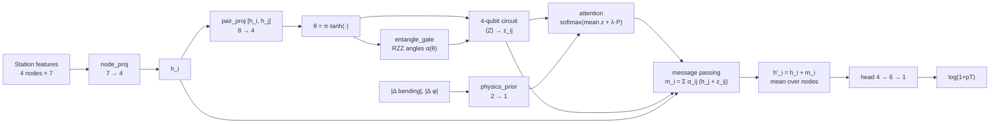

### Quantum interaction block

  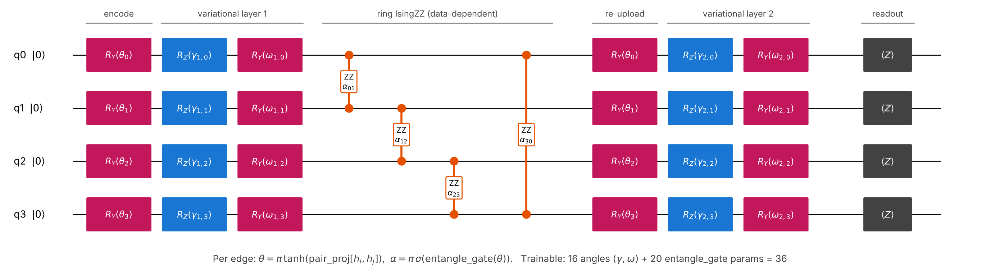

For each edge, 4 angles θ are encoded with RY gates, followed by a variational layer (RZ, RY), a ring of IsingZZ gates whose angles are **computed from the data** (α = π·sigmoid(W·θ + b)), a data re-uploading RY(θ) layer, a second variational layer, and Z-basis measurement on each qubit.

A second RZZ layer placed before the Z measurement was proven to be inert (it is diagonal and cannot change ⟨Z⟩; numerical check: 3.9 × 10⁻¹⁶) and was removed.

### Parameter budget (144)

| Component | Parameters |
|---|---|
| node_proj 7 → 4 | 32 |
| pair_proj 8 → 4 | 36 |
| entangle_gate 4 → 4 (RZZ angles) | 20 |
| Circuit angles (2 layers × 4 qubits × 2) | 16 |
| physics_prior 2 → 1 | 3 |
| head 4 → 6 → 1 | 37 |
| **Total** | **144** |

### Training setup

Adam (lr 1e-3, constant), batch size 64, 50 epochs, SmoothL1 loss (β = 1), gradient clipping at 1.0, L2 weight decay 3e-5 on classical weights only, physics-prior weight λ = 0.1. The best-validation checkpoint is evaluated on the test set.

**Fast simulator:** each epoch runs as a single XLA call (`lax.scan`) with an exact real-arithmetic 4-qubit simulator. The closed-form circuit matches PennyLane `default.qubit` to 2 × 10⁻⁷.

---

## 📊 Main Results

  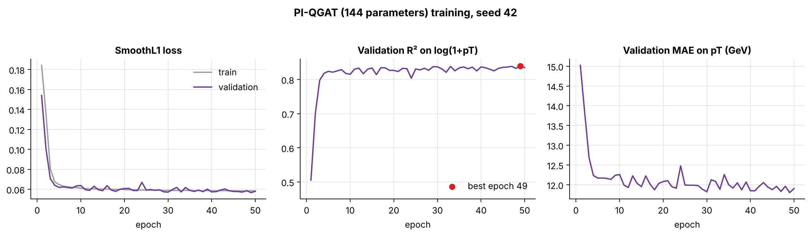

| Metric (test set) | Value |
|---|---|
| R² (log pT) | **0.8395** |
| MAE (log pT) | 0.2143 |
| RMSE (log pT) | 0.3763 |
| MAE (pT) | **11.85 GeV** |
| RMSE (pT) | 126.86 GeV |
| Inference (folded circuit) | 3.90 µs/event, ≈256k events/s |
| Latency, batch 1 / 64 / 1024 | 0.44 / 0.75 / 4.90 ms |
| Model size | 576 bytes (float32), 288 bytes (float16, ΔR² = −0.00005) |

### Performance by pT class

  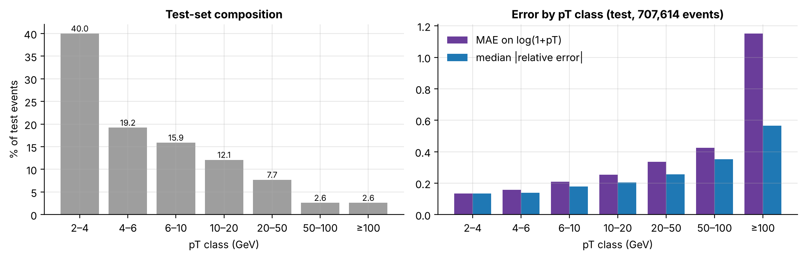

Accuracy is best for low-pT muons, which make up most of the data. The ≥100 GeV class is only 2.6% of events but accounts for 99.5% of the squared error in pT, which is why the GeV-scale RMSE is large.

---

## ⚖️ Quantum vs Classical Interaction Block

  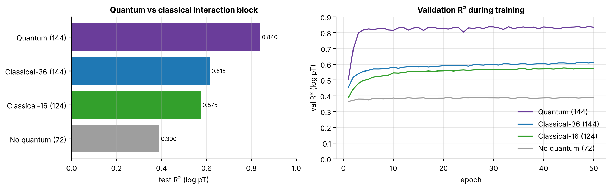

Everything except the interaction block is identical (same layers, initialisation, seeds and batch order).

| Variant | Params | Test R² | MAE (GeV) |
|---|---|---|---|
| **Quantum** | 144 | **0.8395** | **11.85** |
| Classical-36: tanh MLP, parameter-matched | 144 | 0.6150 | 14.49 |
| Classical-16: tanh(Wθ), no RZZ generator | 124 | 0.5750 | 14.69 |
| No interaction block | 72 | 0.3904 | 15.44 |

### Distilling the circuit into a classical network

  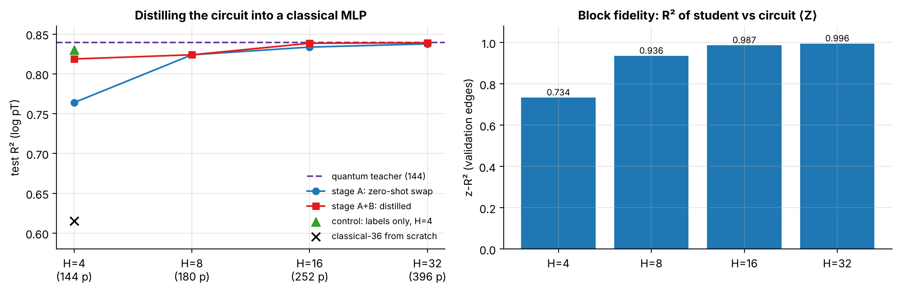

The trained quantum block was replaced by a classical MLP student of hidden width H, first fitted label-free to the circuit's outputs (stage A, "zero-shot swap"), then fine-tuned with knowledge distillation (stage B).

| Model | Params | Test R² | ΔR² vs teacher | µs/event |
|---|---|---|---|---|
| Quantum teacher | 144 | 0.8395 | – | 6.79 |
| Distilled, H = 4 | 144 | 0.8187 | −0.0209 | 1.95 |
| Distilled, H = 8 | 180 | 0.8239 | −0.0157 | 2.12 |
| Distilled, H = 16 | 252 | 0.8384 | −0.0011 | 2.84 |
| Distilled, H = 32 | 396 | 0.8390 | −0.0005 | 4.09 |
| Control: labels only, warm-started trunk, H = 4 | 144 | 0.8301 | −0.0095 | 2.00 |

**Reading:** a classical student with a warm-started trunk gets close to the teacher, while the same-size classical block trained from scratch reaches only 0.6150. This suggests the circuit's main contribution is a better optimisation path, not a function class beyond classical reach. Fully absorbing the circuit takes about 16 hidden units.

---

## 🧪 Ablation Studies

### Physics prior

  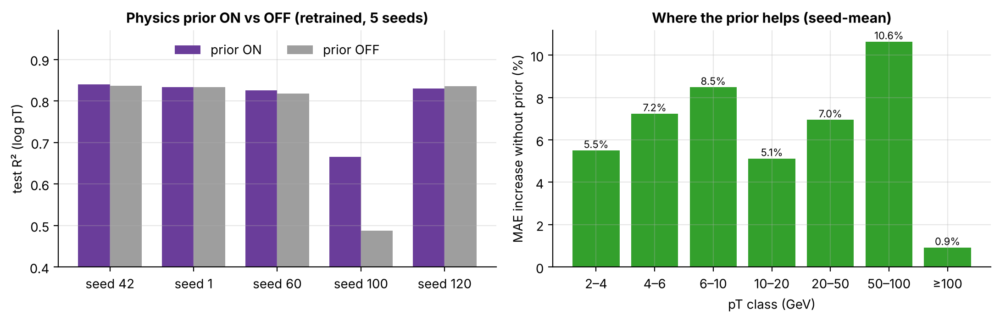

The physics prior adds |Δ bending angle| and |Δ φ| between stations to the attention logits. Over 5 seeds, the prior improves mean R² by +0.036 and lowers MAE in every pT class, but the gain is not statistically significant (paired t-test p = 0.36) because of one unstable seed (seed 100). On the other 4 seeds, the two variants are within 0.008 R².

### Quantum circuit design

  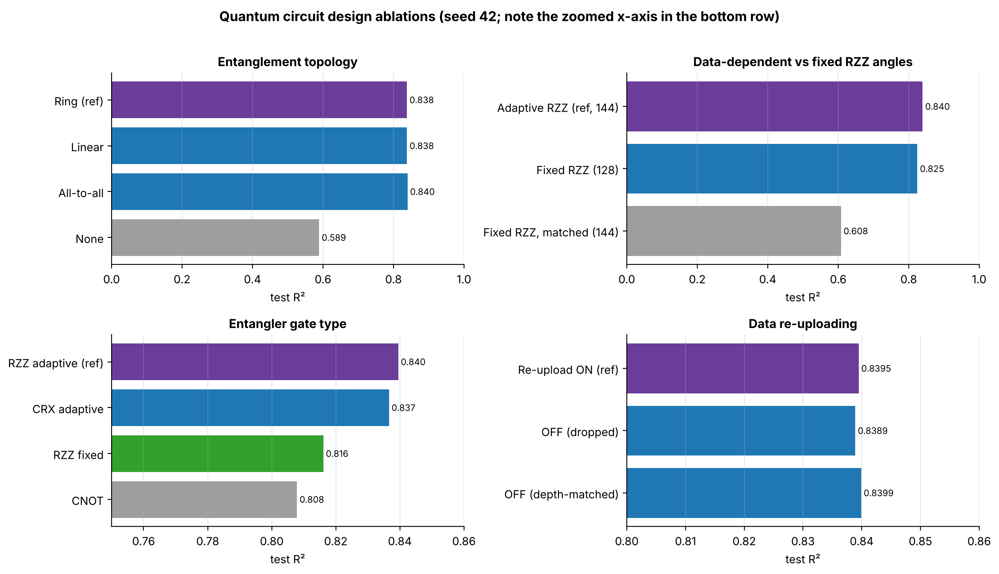

- **Entanglement topology:** any entanglement is essential (none: R² 0.589), but the specific topology barely matters (ring, linear and all-to-all are within 0.0015).
- **Adaptive vs fixed RZZ:** data-dependent RZZ angles beat fixed angles (0.8395 vs 0.8247).
- **Entangler gate:** adaptive CRX (0.8366) nearly matches adaptive RZZ, while fixed RZZ (0.8161) and CNOT (0.8079) are clearly worse. Adaptivity matters about **8×** more than the gate type.
- **Data re-uploading:** no measurable effect (all variants within 0.001).

### Number of qubits, depth and initialisation

  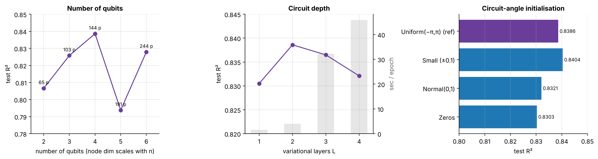

- **Qubits:** 4 qubits performs best (0.8386). Note that the node dimension scales with the qubit count, so parameters change too.
- **Depth:** 2 variational layers is the sweet spot. Depth 3 and 4 are slightly worse and 8–11× slower per epoch.
- **Initialisation:** all schemes land within 0.01 R², i.e. within single-seed noise.

### Muon stations

  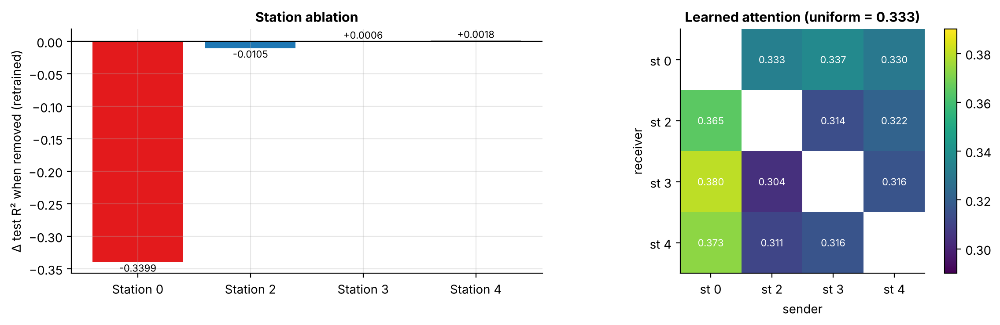

**Station 0 is by far the most important:** removing it drops R² by 0.34. Removing station 2 costs 0.01, and stations 3 and 4 can be removed with no loss. The learned attention also places the most weight on station 0 as a sender.

### Input features

  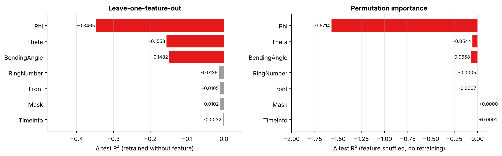

**Phi, Theta and BendingAngle carry almost all the information.** Phi matters most by far. RingNumber, Front, Mask and TimeInfo each cost at most 0.014 R² when removed.

### Graph attention and message passing

  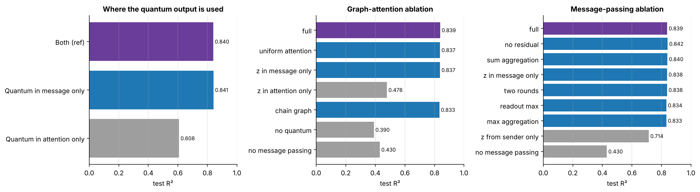

- **The quantum output matters in the message, not in the attention.** Using it only in the message gives 0.8410; using it only in the attention drops to 0.6078.
- Learned attention is close to uniform (entropy 0.985), and forcing uniform attention costs only 0.001 R².
- Removing message passing entirely drops R² to 0.43. The edge function must see **both** stations: using only the sender drops R² to 0.71.
- Standard GNN design choices (residual connection, sum or max aggregation, two rounds, max readout) change R² by less than 0.006.

---

## 📋 Summary of All Results

All values are on the 707,614-event test set. R² is on log(1+pT), MAE is on pT in GeV, and ΔR² is the change relative to the **bold** reference row of each table. All experiments use seed 42 except the physics-prior study (5 seeds). Differences below about 0.01 R² are within single-seed noise.

### Main model

| Model | Params | Test R² | MAE (GeV) | RMSE (GeV) | µs/event |
|---|---|---|---|---|---|
| PI-QGAT (quantum) | 144 | 0.8395 | 11.852 | 126.864 | 3.90 |

### Quantum vs classical interaction block

| Variant | Params | Test R² | ΔR² | MAE (GeV) |
|---|---|---|---|---|
| **Quantum** | **144** | **0.8395** | – | **11.852** |
| Classical-36 (parameter-matched) | 144 | 0.6150 | −0.2245 | 14.486 |
| Classical-16 (no RZZ generator) | 124 | 0.5750 | −0.2645 | 14.693 |
| No interaction block | 72 | 0.3904 | −0.4491 | 15.440 |

### Distillation into a classical student

| Student | Params | Test R² | ΔR² vs teacher | MAE (GeV) |
|---|---|---|---|---|
| **Quantum teacher** | **144** | **0.8395** | – | **11.852** |
| Zero-shot swap, H = 4 | 144 | 0.7639 | −0.0756 | 13.105 |
| Distilled, H = 4 | 144 | 0.8187 | −0.0209 | 12.197 |
| Distilled, H = 8 | 180 | 0.8239 | −0.0157 | 12.150 |
| Distilled, H = 16 | 252 | 0.8384 | −0.0011 | 11.878 |
| Distilled, H = 32 | 396 | 0.8390 | −0.0005 | 11.821 |
| Control (labels only), H = 4 | 144 | 0.8301 | −0.0095 | 12.005 |

### Physics prior (5 seeds, mean ± std)

| Variant | Params | Test R² | ΔR² | MAE (GeV) |
|---|---|---|---|---|
| **Prior ON** | **144** | **0.7987 ± 0.0750** | – | **12.313 ± 0.838** |
| Prior OFF | 144 | 0.7623 ± 0.1540 | −0.0364 | 12.627 ± 1.446 |

Paired t-test p = 0.36; prior ON wins in 3 of 5 seeds on R² and 4 of 5 on MAE.

### Entanglement topology

| Topology | Params | Test R² | ΔR² | MAE (GeV) |
|---|---|---|---|---|
| **Ring** | **144** | **0.8383** | – | **11.861** |
| Linear | 144 | 0.8384 | +0.0001 | 11.862 |
| All-to-all | 144 | 0.8398 | +0.0015 | 11.873 |
| None | 124 | 0.5890 | −0.2492 | 14.673 |

### Adaptive vs fixed RZZ angles

| Variant | Params | Test R² | ΔR² | MAE (GeV) |
|---|---|---|---|---|
| **Adaptive RZZ** | **144** | **0.8395** | – | **11.852** |
| Fixed RZZ | 128 | 0.8247 | −0.0148 | 12.118 |
| Fixed RZZ (parameter-matched) | 144 | 0.6079 | −0.2316 | 14.492 |

### Entangler gate type

| Gate | Params | Test R² | ΔR² | MAE (GeV) |
|---|---|---|---|---|
| **RZZ adaptive** | **144** | **0.8395** | – | **11.852** |
| CRX adaptive | 144 | 0.8366 | −0.0029 | 11.901 |
| RZZ fixed | 141 | 0.8161 | −0.0234 | 12.277 |
| CNOT | 146 | 0.8079 | −0.0316 | 12.273 |

### Data re-uploading

| Variant | Params | Test R² | ΔR² | MAE (GeV) |
|---|---|---|---|---|
| **Re-uploading ON** | **144** | **0.8395** | – | **11.852** |
| OFF (dropped) | 144 | 0.8389 | −0.0006 | 11.891 |
| OFF (depth-matched) | 144 | 0.8399 | +0.0004 | 11.908 |

### Where the quantum output is used

| Variant | Params | Test R² | ΔR² | MAE (GeV) |
|---|---|---|---|---|
| **Attention + message** | **144** | **0.8395** | – | **11.852** |
| Message only | 144 | 0.8410 | +0.0015 | 11.854 |
| Attention only | 144 | 0.6078 | −0.2317 | 14.497 |

### Circuit capacity (parameter-matched)

| Qubits | Params | Test R² | ΔR² | MAE (GeV) |
|---|---|---|---|---|
| 2 | 141 | 0.8351 | −0.0035 | 11.917 |
| 3 | 145 | 0.8336 | −0.0049 | 11.952 |
| **4** | **144** | **0.8386** | – | **11.856** |

### Number of qubits (node dimension scales with qubits)

| Qubits | Params | Test R² | ΔR² | MAE (GeV) | sec/epoch |
|---|---|---|---|---|---|
| 2 | 65 | 0.8066 | −0.0320 | 12.409 | 2.12 |
| 3 | 103 | 0.8258 | −0.0128 | 12.144 | 3.60 |
| **4** | **144** | **0.8386** | – | **11.856** | **4.02** |
| 5 | 191 | 0.7938 | −0.0448 | 12.265 | 6.02 |
| 6 | 244 | 0.8279 | −0.0107 | 12.095 | 6.75 |

### Circuit depth

| Variational layers | Params | Test R² | ΔR² | MAE (GeV) | sec/epoch |
|---|---|---|---|---|---|
| 1 (no entangler) | 116 | 0.8305 | −0.0081 | 11.936 | 1.55 |
| **2** | **144** | **0.8386** | – | **11.856** | **4.02** |
| 3 | 172 | 0.8365 | −0.0021 | 11.868 | 32.28 |
| 4 | 200 | 0.8321 | −0.0064 | 11.986 | 45.89 |

### Entanglement strategy

| Entangler | Params | Test R² | ΔR² | MAE (GeV) |
|---|---|---|---|---|
| None | 124 | 0.5890 | −0.2495 | 14.673 |
| Chain ZZ | 139 | 0.8385 | −0.0001 | 11.862 |
| **Ring ZZ** | **144** | **0.8386** | – | **11.856** |
| All-to-all ZZ | 154 | 0.8375 | −0.0011 | 11.879 |
| Ring ZZ, fixed angles | 128 | 0.8271 | −0.0115 | 12.126 |
| CNOT ring | 124 | 0.8146 | −0.0240 | 12.343 |

### Circuit-angle initialisation

| Initialisation | Params | Test R² | ΔR² | MAE (GeV) |
|---|---|---|---|---|
| **Uniform(−π, π)** | **144** | **0.8386** | – | **11.856** |
| Small (±0.1) | 144 | 0.8404 | +0.0019 | 11.915 |
| Normal(0, 1) | 144 | 0.8321 | −0.0064 | 11.993 |
| Zeros | 144 | 0.8303 | −0.0083 | 11.938 |

### Muon stations

| Station removed | Test R² | ΔR² (retrained) | MAE (GeV) | ΔR² (shuffled, no retraining) |
|---|---|---|---|---|
| **None (all 4)** | **0.8395** | – | **11.852** | – |
| Station 0 | 0.4997 | −0.3399 | 15.442 | −1.0509 |
| Station 2 | 0.8290 | −0.0105 | 11.988 | −1.0182 |
| Station 3 | 0.8402 | +0.0006 | 11.765 | −1.0077 |
| Station 4 | 0.8413 | +0.0018 | 11.809 | −1.0069 |

### Input features

| Feature removed | Params | Test R² | ΔR² (retrained) | MAE (GeV) | ΔR² (shuffled, no retraining) |
|---|---|---|---|---|---|
| **None** | **144** | **0.8395** | – | **11.852** | – |
| Phi | 140 | 0.4930 | −0.3465 | 15.169 | −1.5714 |
| Theta | 140 | 0.6838 | −0.1558 | 13.536 | −0.0544 |
| BendingAngle | 140 | 0.6913 | −0.1482 | 13.783 | −0.0658 |
| RingNumber | 140 | 0.8259 | −0.0136 | 12.045 | −0.0005 |
| Front | 140 | 0.8290 | −0.0105 | 12.080 | −0.0007 |
| Mask | 140 | 0.8293 | −0.0102 | 12.062 | +0.0000 |
| TimeInfo | 140 | 0.8363 | −0.0032 | 11.914 | +0.0001 |

### Graph attention

| Variant | Params | Test R² | ΔR² | MAE (GeV) |
|---|---|---|---|---|
| **Full** | **144** | **0.8385** | – | **11.856** |
| Uniform attention | 141 | 0.8374 | −0.0011 | 11.931 |
| Quantum output in message only | 144 | 0.8372 | −0.0013 | 11.861 |
| Chain graph | 144 | 0.8333 | −0.0052 | 11.906 |
| Quantum output in attention only | 144 | 0.4783 | −0.3602 | 15.112 |
| No message passing | 69 | 0.4300 | −0.4085 | 15.350 |
| No quantum | 72 | 0.3904 | −0.4481 | 15.440 |

### Message passing

| Variant | Params | Test R² | ΔR² | MAE (GeV) |
|---|---|---|---|---|
| **Full** | **144** | **0.8387** | – | **11.880** |
| No residual | 144 | 0.8419 | +0.0032 | 11.865 |
| Sum aggregation | 141 | 0.8401 | +0.0014 | 11.820 |
| Quantum output in message only | 144 | 0.8378 | −0.0009 | 11.894 |
| Two rounds | 144 | 0.8376 | −0.0012 | 11.820 |
| Max readout | 144 | 0.8335 | −0.0052 | 11.945 |
| Max aggregation | 141 | 0.8328 | −0.0059 | 11.916 |
| Quantum output from sender only | 128 | 0.7142 | −0.1245 | 13.157 |
| No message passing | 69 | 0.4300 | −0.4087 | 15.350 |

---

## 🏆 Key Findings

1. A 144-parameter hybrid quantum–classical GNN reaches R² 0.84 on muon pT regression over 707k test events, at under 4 µs per event.
2. The quantum block clearly outperforms parameter-matched classical blocks trained from scratch, but distillation shows its function can be represented classically. The advantage is best described as an optimisation advantage.
3. Within the circuit, **data-dependent entangling angles** are what matter. Topology, gate type, re-uploading, depth and initialisation have small effects.
4. Station 0 and the Phi, Theta and BendingAngle features carry most of the predictive information.

---

## 🛠️ Technologies Used

- **JAX** – Fast exact circuit simulation and training (XLA, `lax.scan`)
- **PennyLane** – Circuit correctness verification
- **NumPy, pandas, scikit-learn** – Data processing and metrics
- **PyTorch** – Data preparation utilities
- **Matplotlib** – Figures
- **kagglehub** – Dataset download
