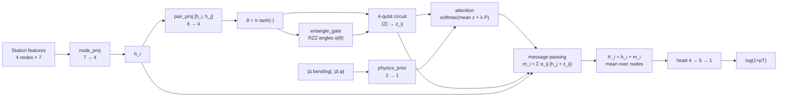

# PI-QGAT: Physics-Informed Quantum Graph Attention Network for Muon pT Regression

A compact hybrid quantum–classical graph neural network that predicts the transverse momentum (pT) of muons from CMS endcap muon trigger hits. The model has only **144 trainable parameters** and uses a 4-qubit variational circuit as the edge-interaction block of a graph attention network. The quantum circuit is simulated exactly with a fast closed-form JAX backend, verified against PennyLane.

The repository contains the main model and a broad ablation study covering the quantum circuit design, the physics prior, the graph architecture, the detector stations and the input features.

---

## 📌 Highlights

- **Test R² = 0.8395** on log(1+pT) and **MAE = 11.85 GeV** on 707,614 held-out events, with just 144 parameters (288 bytes in float16).
- **Fast inference:** 3.9 µs per event (≈256k events/s on CPU) using the constant-folded circuit.
- The quantum interaction block beats a **parameter-matched classical block trained from scratch** by +0.22 R² (0.8395 vs 0.6150).
- **Distillation shows the circuit's function is classically representable:** a 252-parameter classical student reaches R² 0.8384 (within 0.001 of the teacher), and a warm-started 144-parameter classical control reaches 0.8301. The quantum block's main value here appears to be a better optimisation path rather than a function class that classical models cannot express.
- **Entanglement matters, topology does not:** removing entanglement drops R² by 0.25, while ring, linear and all-to-all topologies differ by only 0.0015.
- **Data-dependent entangling angles** are the key ingredient: adaptive RZZ beats fixed RZZ, and the attribution analysis shows adaptivity matters about 8× more than the choice of gate.

---

## 🔬 Problem and Data

| Item | Value |
|---|---|
| Dataset | [CMS Trigger Dataset](https://www.kaggle.com/datasets/prateekagnihotri/cms-trigger-dataset) (Kaggle, `prateekagnihotri/cms-trigger-dataset`) |
| Events | 1,179,356 (no rows removed by cleaning) |
| Split | 20% train (235,871) / 20% validation (235,871) / 60% test (707,614) |
| Stations (graph nodes) | 4 muon stations: 0, 2, 3, 4 |
| Features per station | Phi, Theta, BendingAngle, TimeInfo, RingNumber, Front, Mask (7) |
| Target | log(1 + pT), with pT = \|1 / (q/pT)\| |

Each event is a fully connected graph of 4 station nodes with 12 directed edges.

---

## ⚛️ Model Architecture



### Quantum interaction block

<p align="center">
  
</p>

For each edge, 4 angles θ are encoded with RY gates, followed by a variational layer (RZ, RY), a ring of IsingZZ gates whose angles are **computed from the data** (α = π·sigmoid(W·θ + b)), a data re-uploading RY(θ) layer, a second variational layer, and Z-basis measurement on each qubit.

A second RZZ layer placed before the Z measurement was proven to be inert (it is diagonal and cannot change ⟨Z⟩; numerical check: 3.9 × 10⁻¹⁶) and was removed.

### Parameter budget (144)

| Component | Parameters |
|---|---|
| node_proj 7 → 4 | 32 |
| pair_proj 8 → 4 | 36 |
| entangle_gate 4 → 4 (RZZ angles) | 20 |
| Circuit angles (2 layers × 4 qubits × 2) | 16 |
| physics_prior 2 → 1 | 3 |
| head 4 → 6 → 1 | 37 |
| **Total** | **144** |

### Training setup

Adam (lr 1e-3, constant), batch size 64, 50 epochs, SmoothL1 loss (β = 1), gradient clipping at 1.0, L2 weight decay 3e-5 on classical weights only, physics-prior weight λ = 0.1. The best-validation checkpoint is evaluated on the test set.

**Fast simulator:** each epoch runs as a single XLA call (`lax.scan`) with an exact real-arithmetic 4-qubit simulator. The closed-form circuit matches PennyLane `default.qubit` to 2 × 10⁻⁷.

---

## 📊 Main Results

<p align="center">
  
</p>

| Metric (test set) | Value |
|---|---|
| R² (log pT) | **0.8395** |
| MAE (log pT) | 0.2143 |
| RMSE (log pT) | 0.3763 |
| MAE (pT) | **11.85 GeV** |
| RMSE (pT) | 126.86 GeV |
| Inference (folded circuit) | 3.90 µs/event, ≈256k events/s |
| Latency, batch 1 / 64 / 1024 | 0.44 / 0.75 / 4.90 ms |
| Model size | 576 bytes (float32), 288 bytes (float16, ΔR² = −0.00005) |

### Performance by pT class

<p align="center">
  
</p>

Accuracy is best for low-pT muons, which make up most of the data. The ≥100 GeV class is only 2.6% of events but accounts for 99.5% of the squared error in pT, which is why the GeV-scale RMSE is large.

---

## ⚖️ Quantum vs Classical Interaction Block

<p align="center">
  
</p>

Everything except the interaction block is identical (same layers, initialisation, seeds and batch order).

| Variant | Params | Test R² | MAE (GeV) |
|---|---|---|---|
| **Quantum** | 144 | **0.8395** | **11.85** |
| Classical-36: tanh MLP, parameter-matched | 144 | 0.6150 | 14.49 |
| Classical-16: tanh(Wθ), no RZZ generator | 124 | 0.5750 | 14.69 |
| No interaction block | 72 | 0.3904 | 15.44 |

### Distilling the circuit into a classical network

<p align="center">
  
</p>

The trained quantum block was replaced by a classical MLP student of hidden width H, first fitted label-free to the circuit's outputs (stage A, "zero-shot swap"), then fine-tuned with knowledge distillation (stage B).

| Model | Params | Test R² | ΔR² vs teacher | µs/event |
|---|---|---|---|---|
| Quantum teacher | 144 | 0.8395 | – | 6.79 |
| Distilled, H = 4 | 144 | 0.8187 | −0.0209 | 1.95 |
| Distilled, H = 8 | 180 | 0.8239 | −0.0157 | 2.12 |
| Distilled, H = 16 | 252 | 0.8384 | −0.0011 | 2.84 |
| Distilled, H = 32 | 396 | 0.8390 | −0.0005 | 4.09 |
| Control: labels only, warm-started trunk, H = 4 | 144 | 0.8301 | −0.0095 | 2.00 |

**Reading:** a classical student with a warm-started trunk gets close to the teacher, while the same-size classical block trained from scratch reaches only 0.6150. This suggests the circuit's main contribution is a better optimisation path, not a function class beyond classical reach. Fully absorbing the circuit takes about 16 hidden units.

---

## 🧪 Ablation Studies

### Physics prior

<p align="center">
  
</p>

The physics prior adds |Δ bending angle| and |Δ φ| between stations to the attention logits. Over 5 seeds, the prior improves mean R² by +0.036 and lowers MAE in every pT class, but the gain is not statistically significant (paired t-test p = 0.36) because of one unstable seed (seed 100). On the other 4 seeds, the two variants are within 0.008 R².

### Quantum circuit design

<p align="center">
  
</p>

- **Entanglement topology:** any entanglement is essential (none: R² 0.589), but the specific topology barely matters (ring, linear and all-to-all are within 0.0015).
- **Adaptive vs fixed RZZ:** data-dependent RZZ angles beat fixed angles (0.8395 vs 0.8247).
- **Entangler gate:** adaptive CRX (0.8366) nearly matches adaptive RZZ, while fixed RZZ (0.8161) and CNOT (0.8079) are clearly worse. Adaptivity matters about **8×** more than the gate type.
- **Data re-uploading:** no measurable effect (all variants within 0.001).

### Number of qubits, depth and initialisation

<p align="center">
  
</p>

- **Qubits:** 4 qubits performs best (0.8386). Note that the node dimension scales with the qubit count, so parameters change too.
- **Depth:** 2 variational layers is the sweet spot. Depth 3 and 4 are slightly worse and 8–11× slower per epoch.
- **Initialisation:** all schemes land within 0.01 R², i.e. within single-seed noise.

### Muon stations

<p align="center">
  
</p>

**Station 0 is by far the most important:** removing it drops R² by 0.34. Removing station 2 costs 0.01, and stations 3 and 4 can be removed with no loss. The learned attention also places the most weight on station 0 as a sender.

### Input features

<p align="center">
  
</p>

**Phi, Theta and BendingAngle carry almost all the information.** Phi matters most by far. RingNumber, Front, Mask and TimeInfo each cost at most 0.014 R² when removed.

### Graph attention and message passing

<p align="center">
  
</p>

- **The quantum output matters in the message, not in the attention.** Using it only in the message gives 0.8410; using it only in the attention drops to 0.6078.
- Learned attention is close to uniform (entropy 0.985), and forcing uniform attention costs only 0.001 R².
- Removing message passing entirely drops R² to 0.43. The edge function must see **both** stations: using only the sender drops R² to 0.71.
- Standard GNN design choices (residual connection, sum or max aggregation, two rounds, max readout) change R² by less than 0.006.

---

## 🏆 Key Findings

1. A 144-parameter hybrid quantum–classical GNN reaches R² 0.84 on muon pT regression over 707k test events, at under 4 µs per event.
2. The quantum block clearly outperforms parameter-matched classical blocks trained from scratch, but distillation shows its function can be represented classically. The advantage is best described as an optimisation advantage.
3. Within the circuit, **data-dependent entangling angles** are what matter. Topology, gate type, re-uploading, depth and initialisation have small effects.
4. Station 0 and the Phi, Theta and BendingAngle features carry most of the predictive information.

## ⚠️ Limitations

- Most ablations use a **single seed (42)**. The seed-to-seed spread of R² is about 0.006–0.01, so smaller gaps are not reliable.
- The physics-prior study (5 seeds) shows one unstable seed, so seed variance is a real concern for this model.
- The quantum circuit is **simulated exactly on classical hardware**; no runs were performed on quantum devices.
- Errors in pT (GeV) are dominated by the rare ≥100 GeV class.

---

## 📁 Repository Structure

```
PI-QGAT/
│
├── README.md
├── requirements.txt
├── images/                                   # Figures used in this README
│   ├── 00_quantum_circuit.png
│   ├── 01_training_curves.png
│   ├── 02_per_pt_class.png
│   ├── 03_quantum_vs_classical.png
│   ├── 04_distillation.png
│   ├── 05_physics_prior.png
│   ├── 06_circuit_design_ablations.png
│   ├── 07_qubits_depth_init.png
│   ├── 08_station_ablation.png
│   ├── 09_feature_ablation.png
│   └── 10_attention_message_passing.png
│
├── notebooks/
│   ├── jax_piqgata_fast.ipynb                # Data, main model, quantum-vs-classical, distillation
│   └── jax_piqgata_ablation_experiments.ipynb  # All ablation studies
│
└── scripts/
    └── make_figures.py                       # Rebuilds the README figures from notebook outputs
```

---

## 🚀 Getting Started

The notebooks are designed for **Google Colab or Kaggle**. The dataset is downloaded automatically with `kagglehub`.

```bash
pip install jax pennylane kagglehub numpy pandas scikit-learn torch matplotlib
```

Run the cells in order:

1. **Cell 0:** package installs
2. **Cell 1:** data download, cleaning, 20/20/60 split, graph construction
3. **Cell 3:** train and evaluate the 144-parameter PI-QGAT
4. **Cell 4:** quantum vs classical ablation
5. **Cell 5:** distillation into classical students
6. **Ablation cells:** each one is independent and only needs Cells 0 and 1

To reproduce multi-seed results, set `SEEDS = [42, 1, 60, 100, 120]` in the relevant cell.

---

## 🛠️ Technologies Used

- **JAX** – Fast exact circuit simulation and training (XLA, `lax.scan`)
- **PennyLane** – Circuit correctness verification
- **NumPy, pandas, scikit-learn** – Data processing and metrics
- **PyTorch** – Data preparation utilities
- **Matplotlib** – Figures
- **kagglehub** – Dataset download
